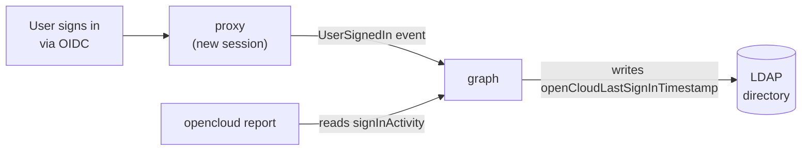

# User Reporting

`opencloud report` counts the users of a running instance and groups them by their assigned role. It
answers the two questions that come up for licence and usage reporting: how many accounts exist per
role, and how many of those accounts were actually used recently.

The numbers are read from the Libre Graph API as the configured service account. The command only
reads, but the instance has to be running while the report is generated.

:::note Availability
`opencloud report` is not part of a released version yet. Once it ships, replace this note with the
release it first appears in.
:::

## Running the report

The command talks to the services of the instance through the shared service registry, so it has to
run next to them, not from a remote machine. With Docker Compose, run it inside the OpenCloud
container as described in [Maintenance Commands](./maintenance-commands.md):

```bash
docker compose exec opencloud opencloud report
```

On a single binary installation, run it on the host where the instance is running:

```bash
opencloud report
```

## What the report shows

```text
Sign-in window: last 31 days (since 2026-10-17T09:18:01Z)

Users in total:                    10026
Signed in within the last 31 days: N/A
Users with a recorded sign-in:     0

┌────────────────────┬───────┬───────────────────────────────────┐
│        Role        │ Users │ Signed in within the last 31 days │
├────────────────────┼───────┼───────────────────────────────────┤
│ (no role assigned) │  9919 │                               N/A │
│ User               │   103 │                               N/A │
│ Admin              │     2 │                               N/A │
│ Space Admin        │     1 │                               N/A │
│ User Light         │     1 │                               N/A │
└────────────────────┴───────┴───────────────────────────────────┘
```

The three summary lines are the headcount, how many of those users signed in inside the window, and
how many have a recorded sign-in at all regardless of the window. The last line tells you whether the
sign-in data is usable at all, see
[Sign-in counts and the LDAP integration](#sign-in-counts-and-the-ldap-integration).

Users without any role assignment are reported in their own `(no role assigned)` bucket rather than
dropped, so the role table accounts for every user. A role that OpenCloud cannot resolve to a display
name is reported by its role ID.

Where roles are assigned on first sign-in, which is the default with an external identity provider,
this bucket mostly holds accounts that were provisioned but never used. It is not proof that a user
has no role, though. If the role lookup for a user fails while the report runs, the graph service
logs it at debug level and returns that user without assignments, so they land in the same bucket and
the report cannot tell the two cases apart.

:::note The role column can add up to more than the total
A user holding more than one role assignment is counted once per role. Use `Users in total` for a
headcount and the role rows for the distribution.
:::

## Options

| Flag                         | Default | What it does                                                    |
| ---------------------------- | ------- | --------------------------------------------------------------- |
| `-d`, `--days <n>`           | `31`    | Width of the sign-in window in days. Must be at least 1.        |
| `-o`, `--output <format>`    | `table` | One of `table`, `json`, `csv`, `yaml`.                          |
| `--skip-sign-in`             | off     | Leave the sign-in window out and only count the users per role. |
| `-t`, `--timeout <duration>` | `5m`    | Time budget for the whole run, e.g. `10m`. Must be positive.    |
| `--insecure`                 | off     | Do not verify the TLS certificate of the graph service.         |

`--skip-sign-in` and `--days` cannot be combined. The window has no effect when the sign-ins are not
reported, so the command rejects the combination instead of ignoring the flag:

```text
--skip-sign-in and --days cannot be combined, --skip-sign-in reports no sign-ins at all
```

### Counting users only

`--skip-sign-in` is the right choice when the sign-in counts are not available anyway, which is the
case on a read-only directory. It drops every sign-in field from the output rather than reporting it
as `N/A` or `null`, because nothing was read:

```bash
docker compose exec opencloud opencloud report --skip-sign-in
```

```text
Users in total: 10026

┌────────────────────┬───────┐
│        Role        │ Users │
├────────────────────┼───────┤
│ (no role assigned) │  9919 │
│ User               │   103 │
│ Admin              │     2 │
│ Space Admin        │     1 │
│ User Light         │     1 │
└────────────────────┴───────┘
```

### Instances with many users

The report resolves the role assignments per user through the graph API, so the run grows with the
number of users. The default budget of 5 minutes covers tens of thousands of them. Raise it on a
larger instance:

```bash
docker compose exec opencloud opencloud report -t 15m
```

When the budget runs out the command stops with `context deadline exceeded` and reports nothing.

### TLS and self-signed certificates

With `OC_HTTP_TLS_ENABLED=true` the services speak HTTPS, and the report follows. If
`OC_HTTP_TLS_CERTIFICATE` is not set, OpenCloud generates a certificate that nothing trusts, and the
run stops with `x509: certificate signed by unknown authority`. Skip the check with `--insecure`:

```bash
docker compose exec opencloud opencloud report --insecure
```

Use it only where the certificate is that generated one. With a certificate from a CA the host
trusts, the report works without the flag.

## Machine readable output

`json` and `yaml` carry the same fields as the table. `csv` repeats the report totals on every row, so
a single flat table holds the summary as well:

```json
{
  "generatedAt": "2026-11-17T09:32:05.592286966Z",
  "days": 31,
  "activeSince": "2026-10-17T09:32:05.592286966Z",
  "totalUsers": 6,
  "activeUsers": 3,
  "usersWithSignInData": 3,
  "roles": [
    { "role": "User", "users": 3, "signedIn": 1 },
    { "role": "Admin", "users": 2, "signedIn": 1 }
  ]
}
```

```text
days,activeSince,totalUsers,activeUsers,usersWithSignInData,role,users,signedIn
31,2026-10-17T09:32:10Z,6,3,3,User,3,1
31,2026-10-17T09:32:10Z,6,3,3,Admin,2,1
```

With `--skip-sign-in` the sign-in fields are absent instead of empty, and `csv` reduces to
`totalUsers,role,users`.

## Sign-in counts and the LDAP integration

Whether the sign-in columns hold numbers or `N/A` depends entirely on whether OpenCloud may write to
the LDAP directory. OpenCloud keeps no database of its own for this: the timestamp of the last
successful sign-in is stored as an attribute on the user entry in the directory.

### How a sign-in is recorded



Only a new OIDC session produces the event. Other ways of authenticating against the API do not, so
an instance can be in daily use and still show no recorded sign-ins if its directory does not accept
the write.

### Writable directory

`OC_LDAP_SERVER_WRITE_ENABLED` defaults to `true`, which is the setting used with the built-in
identity management. The graph service then writes `openCloudLastSignInTimestamp` on every new
session, and the report returns real counts:

```text
Users in total:                    6
Signed in within the last 31 days: 3
Users with a recorded sign-in:     3

┌─────────────┬───────┬───────────────────────────────────┐
│    Role     │ Users │ Signed in within the last 31 days │
├─────────────┼───────┼───────────────────────────────────┤
│ User        │     3 │                                 1 │
│ Admin       │     2 │                                 1 │
│ Space Admin │     1 │                                 1 │
└─────────────┴───────┴───────────────────────────────────┘
```

Two conditions have to hold beyond the variable itself. The directory schema must allow the
`openCloudLastSignInTimestamp` attribute on the user entries, which a directory using its own schema
rather than the OpenCloud one usually does not. And `OC_LDAP_SERVER_WRITE_ENABLED` is only supported
while the user and group attribute mappings are left at their defaults, so a deployment with a custom
schema mapping should not switch it on.

### Read-only directory

An external directory is usually read-only for OpenCloud, with
`OC_LDAP_SERVER_WRITE_ENABLED=false`, because the external identity management owns all user
management including deprovisioning. This is the setup described in
[Keycloak](../configuration/authentication-and-user-management/keycloak.md).

The graph service then skips the update without failing the sign-in: the user is logged in normally,
but no timestamp is stored. No user ever gets a `signInActivity`, so the report cannot tell an account
that was never used from one whose use was never recorded. It reports the counts as `N/A` rather than
`0` and explains why:

```text
Warning: not a single user has a recorded sign-in, so the sign-in
counts are reported as N/A rather than 0. This instance does not store
sign-in timestamps. They are only recorded when the identity backend
is writable, see OC_LDAP_SERVER_WRITE_ENABLED, and when the directory
holds the OpenCloud LDAP schema.
```

:::caution Do not read N/A as "nobody signed in"
`N/A` means the instance stores no sign-in timestamps at all. It says nothing about how active the
users are. Making the directory writable only to collect this number is rarely worth it: it gives
OpenCloud write access to a directory that an external system owns, and it is the identity provider,
not OpenCloud, that holds the authoritative login history.
:::

On a read-only directory, run the report with `--skip-sign-in` and take the login figures from the
identity provider instead.

### The two modes side by side

|                                | Writable directory              | Read-only directory               |
| ------------------------------ | ------------------------------- | --------------------------------- |
| `OC_LDAP_SERVER_WRITE_ENABLED` | `true` (default)                | `false`                           |
| Typical setup                  | Built-in identity management    | External directory, e.g. Keycloak |
| Last sign-in stored            | Yes, on the user entry in LDAP  | No, the write is skipped          |
| Sign-in columns                | Real counts                     | `N/A`, with a warning             |
| `usersWithSignInData`          | Number of users seen signing in | Always `0`                        |
| Recommended invocation         | `opencloud report`              | `opencloud report --skip-sign-in` |
| User counts per role           | Correct                         | Correct                           |

The user and role counts are unaffected by any of this. They come from the directory itself and are
correct in both modes.

## Reading N/A against 0

The report keeps the two apart on purpose, in every format:

| Meaning                                                                                | `table` | `json` and `yaml` | `csv`      |
| -------------------------------------------------------------------------------------- | ------- | ----------------- | ---------- |
| Not available, the instance records no sign-ins                                        | `N/A`   | `null`            | empty cell |
| A real zero, sign-ins are recorded but nobody in this role signed in inside the window | `0`     | `0`               | `0`        |

A role showing `0` on an instance whose other roles show numbers is a genuine finding: those accounts
exist and were not used inside the window. A report showing `N/A` everywhere is a statement about the
deployment, not about the users.
