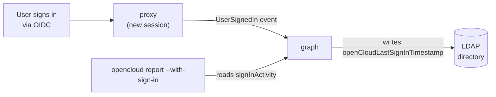

# User Reporting

`opencloud report` counts the users of a running instance and groups them by their assigned role. It
answers the question that comes up for licence and usage reporting: how many accounts exist, and how
they are distributed across roles.

It can additionally report how many of those accounts were used recently, but only on a deployment
that records sign-ins. That part is opt-in, see [Reporting sign-ins](#reporting-sign-ins).

The numbers are read from the Libre Graph API as the configured service account. The command only
reads, but the instance has to be running while the report is generated.

:::note Availability
`opencloud report` is not part of a released version yet. Once it ships, replace this note with the
release it first appears in.
:::

## Running the report

The command talks to the gateway and the graph service directly, so it has to run next to them, not
from a remote machine. With Docker Compose, run it inside the OpenCloud container as described in
[Maintenance Commands](./maintenance-commands.md):

```bash
docker compose exec opencloud opencloud report
```

On a single binary installation, run it on the host where the instance is running:

```bash
opencloud report
```

On Kubernetes, run it in the pod that serves the API, where both services live. No extra
configuration is needed:

```bash
kubectl exec -n <namespace> deploy/<release>-api -- opencloud report
```

## What the report shows

```text
Users in total: 10026

┌────────────────────┬───────┐
│        Role        │ Users │
├────────────────────┼───────┤
│ (no role assigned) │  9919 │
│ User               │   103 │
│ Admin              │     2 │
│ Space Admin        │     1 │
│ User Light         │     1 │
└────────────────────┴───────┘
```

Users without any role assignment are reported in their own `(no role assigned)` bucket rather than
dropped, so the role table accounts for every user. A role that OpenCloud cannot resolve to a display
name is reported by its role ID.

Where roles are assigned on first sign-in, which is the default with an external identity provider,
this bucket mostly holds accounts that were provisioned but never used. It is not proof that a user
has no role, though. If the role lookup for a user fails while the report runs, the graph service
logs it at debug level and returns that user without assignments, so they land in the same bucket and
the report cannot tell the two cases apart.

:::note The role column can add up to more than the total
A user holding more than one role assignment is counted once per role. Use `Users in total` for a
headcount and the role rows for the distribution.
:::

## Options

| Flag                         | Default | What it does                                                     |
| ---------------------------- | ------- | ---------------------------------------------------------------- |
| `--with-sign-in`             | off     | Also report how many users per role signed in recently.          |
| `-d`, `--days <n>`           | `31`    | Width of the sign-in window in days. Only with `--with-sign-in`. |
| `-o`, `--output <format>`    | `table` | One of `table`, `json`, `csv`, `yaml`.                           |
| `-t`, `--timeout <duration>` | `5m`    | Time budget for the whole run, e.g. `10m`. Must be positive.     |
| `--insecure`                 | off     | Do not verify the TLS certificate of the graph service.          |

`--days` on its own is rejected rather than ignored, because it has no effect without the sign-in
window:

```text
--days only applies together with --with-sign-in
```

### Instances with many users

The report resolves the role assignments per user through the graph API, so the run grows with the
number of users. The default budget of 5 minutes covers tens of thousands of them. Raise it on a
larger instance:

```bash
docker compose exec opencloud opencloud report -t 15m
```

When the budget runs out the command stops with `context deadline exceeded` and reports nothing.

### TLS and self-signed certificates

With `OC_HTTP_TLS_ENABLED=true` the services speak HTTPS, and the report follows. If
`OC_HTTP_TLS_CERTIFICATE` is not set, OpenCloud generates a certificate that nothing trusts, and the
run stops with `x509: certificate signed by unknown authority`. Skip the check with `--insecure`:

```bash
docker compose exec opencloud opencloud report --insecure
```

Use it only where the certificate is that generated one. With a certificate from a CA the host
trusts, the report works without the flag.

## Machine readable output

`json` and `yaml` carry the same fields as the table. `csv` repeats the report total on every row, so
a single flat table holds the summary as well:

```json
{
  "generatedAt": "2026-11-19T11:56:23.290875967Z",
  "totalUsers": 6,
  "roles": [
    { "role": "User", "users": 3 },
    { "role": "Admin", "users": 2 }
  ]
}
```

```text
totalUsers,role,users
6,User,3
6,Admin,2
```

The sign-in fields are absent entirely unless `--with-sign-in` is given, rather than present and
empty, because nothing was read.

## Reporting sign-ins

`--with-sign-in` adds, per role, how many of its users signed in successfully within the last
`--days` days:

```bash
docker compose exec opencloud opencloud report --with-sign-in
```

```text
Sign-in window: last 31 days (since 2026-10-19T11:56:16Z)

Users in total:                    6
Signed in within the last 31 days: 2
Users with a recorded sign-in:     2

┌─────────────┬───────┬───────────────────────────────────┐
│    Role     │ Users │ Signed in within the last 31 days │
├─────────────┼───────┼───────────────────────────────────┤
│ User        │     3 │                                 1 │
│ Admin       │     2 │                                 1 │
│ Space Admin │     1 │                                 0 │
└─────────────┴───────┴───────────────────────────────────┘
```

In the machine readable formats the same run adds `days`, `activeSince`, `activeUsers`,
`usersWithSignInData` and a `signedIn` field per role.

### What it needs

OpenCloud keeps no database of its own for this. The timestamp of the last successful sign-in is
stored as an attribute on the user entry in LDAP, so the flag needs an LDAP identity backend that
OpenCloud may write to.



Only a new OIDC session produces the event. Other ways of authenticating against the API do not.

Where the directory does not accept the write, the flag is refused rather than reporting a column of
empty values. An external directory is usually read-only for OpenCloud, with
`OC_LDAP_SERVER_WRITE_ENABLED=false`, because the external identity management owns all user
management including deprovisioning. This is the setup described in
[Keycloak](../configuration/authentication-and-user-management/keycloak.md):

```text
--with-sign-in is not available on this instance: the LDAP identity backend is read-only,
see OC_LDAP_SERVER_WRITE_ENABLED, so no sign-in is ever recorded
```

The `cs3` identity backend never records sign-ins either, and is refused the same way:

```text
--with-sign-in is not available on this instance: the "cs3" identity backend does not record sign-ins
```

On such a deployment, run the report without the flag and take the login figures from the identity
provider, which holds the authoritative login history anyway.

:::caution Making a directory writable only for this is rarely worth it
Switching `OC_LDAP_SERVER_WRITE_ENABLED` on gives OpenCloud write access to a directory that an
external system owns. It also only works while the user and group attribute mappings are left at
their defaults, and the directory schema has to allow the `openCloudLastSignInTimestamp` attribute,
which a directory using its own schema usually does not.
:::

### Reading N/A against 0

On a writable backend the counts can still be unavailable, when no user has a recorded sign-in at
all. That happens before anyone has signed in since recording was switched on, or when the directory
does not hold the OpenCloud schema. The report keeps that apart from a real zero, in every format:

| Meaning                                                                                | `table` | `json` and `yaml` | `csv`      |
| -------------------------------------------------------------------------------------- | ------- | ----------------- | ---------- |
| Not available, no user has a recorded sign-in                                          | `N/A`   | `null`            | empty cell |
| A real zero, sign-ins are recorded but nobody in this role signed in inside the window | `0`     | `0`               | `0`        |

A role showing `0` on an instance whose other roles show numbers is a genuine finding: those accounts
exist and were not used inside the window. A report showing `N/A` everywhere is a statement about the
deployment, not about the users, and the table says so in a warning below it.
